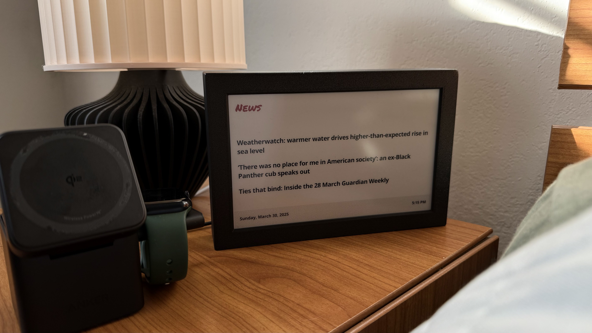
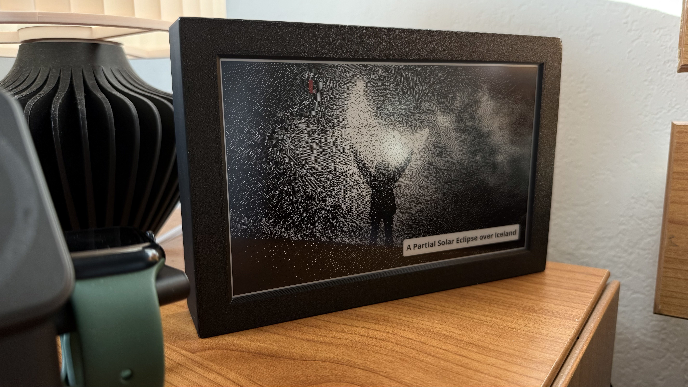

# Scripts for displaying html (React) on remote E-ink display

| News                                                  | Nasa Photo of the Day                                          |
| ----------------------------------------------------- | -------------------------------------------------------------- |
|  |  |

## Basics

- Currently only works with Waveshare e-ink displays. (could be updated to work
  with other brands easily)
- This script currently runs on a Raspberry pi zero w that's connected to the
  net.
- It fetches a list of frame screens to be displayed via
  [eink.schultz.co](https://eink.schultz.co) (feel free to use your own backend)
- That list is then used to fetch the the next image in rotation based on which
  one is currently being displayed on the connected eink display derived from
  state.json.


## Setup

### Installing DietPi (with SPI support)

1. Flash a **DietPi** image for your Raspberry Pi (e.g., Raspberry Pi Zero 2 W) onto a microSD card.
2. Before ejecting the SD card, edit these files on the boot partition for headless WiFi, SSH (enabled by default on DietPi), and SPI:
   - **`dietpi.txt`**:
     ```ini
     AUTO_SETUP_NET_WIFI_ENABLED=1
     AUTO_SETUP_NET_WIFI_COUNTRY_CODE=US
     AUTO_SETUP_NET_HOSTNAME=eink-frame
     ```
   - **`dietpi-wifi.txt`**:
     ```ini
     aWIFI_SSID[0]='YOUR_WIFI_NAME'
     aWIFI_KEY[0]='YOUR_WIFI_PASSWORD'
     ```
   - **`config.txt`** (enables SPI for the Waveshare display):
     ```ini
     dtparam=spi=on
     ```
3. Boot the Pi, wait 2–3 minutes for first-run setup, then SSH in (`ssh root@<pi-ip>`, default password `dietpi`).
4. Run `dietpi-config` to verify two settings:
   - **Advanced Options → SPI State → On** (if not already enabled via `config.txt`; reboot if prompted)
   - **Network Options: Misc → Boot Wait for Network → On** (so boot services wait for WiFi)
5. Install system packages, clone this repo, and set up a Python virtual environment:
   ```shell
   apt update && apt install -y git python3 python3-venv python3-dev build-essential libopenjp2-7
   git clone https://github.com/michaelwschultz/eink-frame.git
   cd eink-frame
   mkdir -p images
   python3 -m venv .venv
   source .venv/bin/activate
   pip install -r requirements.txt
   ```
   *(If `RPi.GPIO` fails on newer kernels such as Debian Trixie, install `rpi-lgpio` and `spidev` inside the venv.)*

### Project configuration

- Update `BACKEND_URL` in [fetch_and_display_image.py](https://github.com/michaelwschultz/eink-frame/blob/main/fetch_and_display_image.py) if you want to point to your own backend instead of `https://eink.schultz.co`
- You may also need to update the imported waveshare eink display you're using in [send_to_display.py](https://github.com/michaelwschultz/eink-frame/blob/main/send_to_display.py)

## Usage

```shell
pip install -r requirements.txt
python fetch_and_display_image.py
```

You can also tell it which frame to display using the param -F or --frame.
```shell
python fetch_and_display_image.py --frame weather
```

### WiFi Setup

If your WiFi credentials change, you don't need to SSH into the Pi or rebuild
anything. Just run the setup portal from your phone:

```shell
python wifi_setup.py
```

This creates a temporary WiFi access point called **eink-frame-setup**. Connect
to it from your phone and a setup page will automatically appear where you can
enter your new SSID and password. Once connected, the Pi shuts down the access
point and joins your network.

**How it works:**
1. The Pi creates an open access point (`eink-frame-setup`)
2. A captive-portal-style web page is served at `http://10.0.0.1`
3. Enter your WiFi network name and password on the page
4. The Pi saves the credentials to `wifi_credentials.json` and connects
5. The access point shuts down automatically

**Auto-connect on startup:** The main script (`fetch_and_display_image.py`) now
attempts to connect using saved credentials before fetching images. If your Pi
loses power and reconnects, it'll automatically rejoin your WiFi network.

**To manually connect with saved credentials** (without starting the portal):
```shell
python wifi_setup.py --connect
```

**Prerequisites:** The setup portal requires `hostapd` and `dnsmasq`, which are
installed automatically on first run if missing.

### Remote backend for fetching data

The backend runs at [eink.schultz.co](https://eink.schultz.co). It serves the
list of frames (`?generate=list`) and generates the frame images
(`?frame=<name>&generate=image`) sent down to the Pi, so you can control which
frames rotate on the display without logging into the Pi once it's set up.

### Run at boot and on a schedule using systemd (recommended on DietPi)

Copy [systemd/eink-frame.service](./systemd/eink-frame.service) and
[systemd/eink-frame.timer](./systemd/eink-frame.timer) into `/etc/systemd/system/`
(update `User` and paths in `eink-frame.service` if the repo isn't in `/root/eink-frame`):

```shell
sudo cp systemd/eink-frame.service systemd/eink-frame.timer /etc/systemd/system/
sudo systemctl daemon-reload
sudo systemctl enable eink-frame.service
sudo systemctl enable --now eink-frame.timer
```

To test immediately and view logs:

```shell
sudo systemctl start eink-frame.service
journalctl -u eink-frame.service -n 50 --no-pager
systemctl list-timers eink-frame.timer
```

### Alternative: Add startup process using pm2

```shell
pm2 start fetch_and_display_image.py --name fetch_and_display --no-autorestart --cron "0 7,19 * * *"
pm2 save
pm2 startup

pm2 logs fetch_and_display
```

## Hardware

Optional [button](./hardware/button.py) and [rotary](./hardware/rotary.py)
button scrips available.

## 3D Printing (more frames to come)

Right now, I'm using
[this design](https://makerworld.com/en/models/787533-waveshare-7-5-inch-e-paper-case#profileId-725479).

Here's
[another design](https://www.printables.com/model/219811-waveshare-75-e-paper-case-symmetrical-borders)
if you're interested in adding a battery to your setup.
